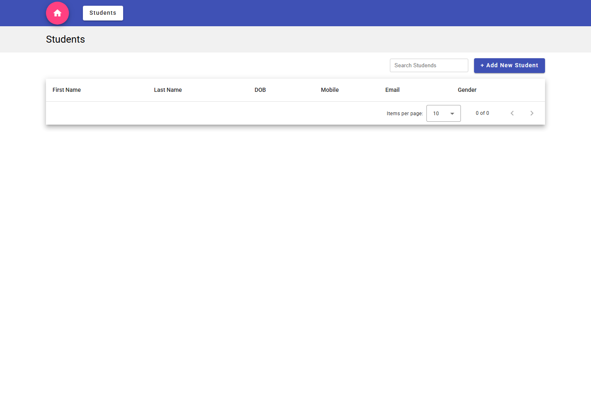
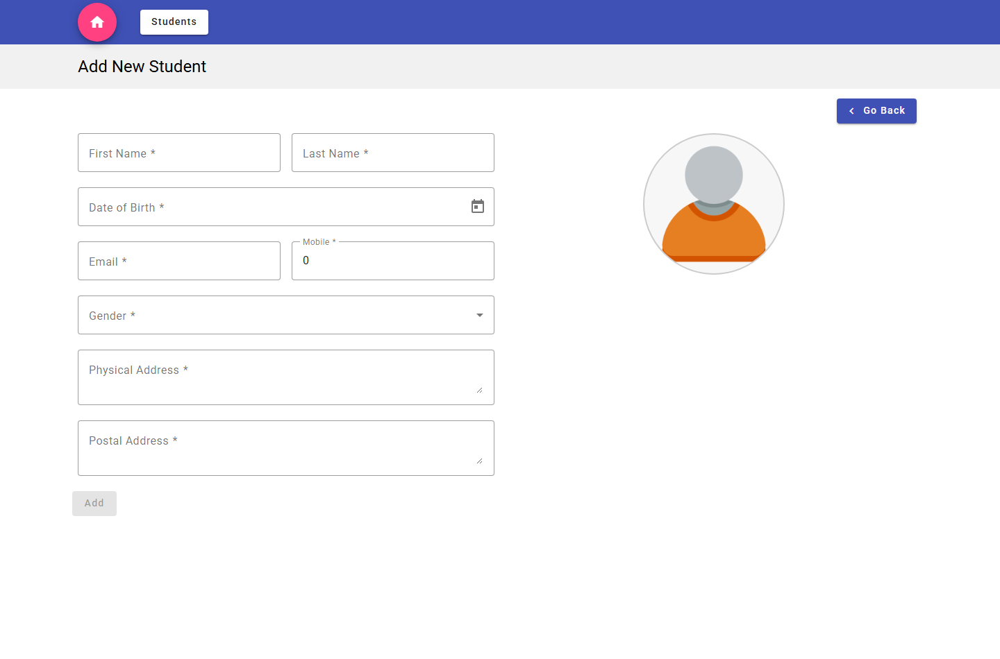

# Student Admin Portal UI

An Angular frontend for browsing and managing student records. It provides a searchable, sortable, paginated student list and forms to add or edit students, including profile-image upload.

## Screenshots

The screenshots show the UI with the API unavailable, so the list is empty and gender choices are not loaded. Start the backend described in [API dependency](#api-dependency) to see live data.





## Technology

- Angular 22.2.3 and Angular CLI
- TypeScript 6
- Angular Material and Flexbox Grid
- RxJS
- Vitest with jsdom and the V8 coverage provider

## Prerequisites

- Node.js 22.22.3 or later in the 22.x line, or 24.15.0 or later in the 24.x line
- npm (included with Node.js)
- The Student Portal backend API, if you need data or want to add, edit, delete, or upload student records

Node.js 24.22.0 and npm 11.19.1 satisfy the frontend's Node.js requirements.

## Run locally

Open PowerShell in this directory (`studentadminportal-ui`) and run:

```powershell
npm ci
npm start
```

Then open <http://localhost:4200/>. `npm ci` installs the exact dependency versions from `package-lock.json`; `npm start` runs Angular's development server.

The UI can render without the backend, but API-backed actions will not work and the student list will remain empty. See [API dependency](#api-dependency).

## Build

```powershell
npm run build
```

The production build is written to `dist/studentadminportal-ui/browser/`.

## Tests and coverage

```powershell
# Watch mode
npm test

# One run, suitable for CI
npm run test:ci

# One run with coverage
npm run test:ci -- --coverage
```

Tests run in Vitest with jsdom; a browser and running backend are not required. The coverage report is written to `coverage/studentadminportal-ui/index.html`.

## API dependency

The frontend currently targets `http://localhost:7255/`. Start the backend separately and configure it to allow requests from the frontend origin (`http://localhost:4200`) through CORS.

Student endpoints used by the UI:

| Operation | Method and path |
| --- | --- |
| List students | `GET /api/Students/GetAllStudent` |
| Get a student | `GET /api/Students/GetStudentById/{id}` |
| Add a student | `POST /api/Students/AddStudent` |
| Update a student | `PUT /api/Students/UpdateStudent/{id}` |
| Delete a student | `DELETE /api/Students/DeleteStudent/{id}` |
| Upload a profile image | `POST /api/Students/UploadProfile/{id}` |
| List genders | `GET /api/Gender/GetGenders` |

The API base URL is currently hardcoded in the services. See the [technical specification](docs/TECHNICAL_SPEC.md) before changing it or deploying the UI.

## More documentation

- [Technical specification](docs/TECHNICAL_SPEC.md) — architecture, routes, API contract, models, and configuration notes.
